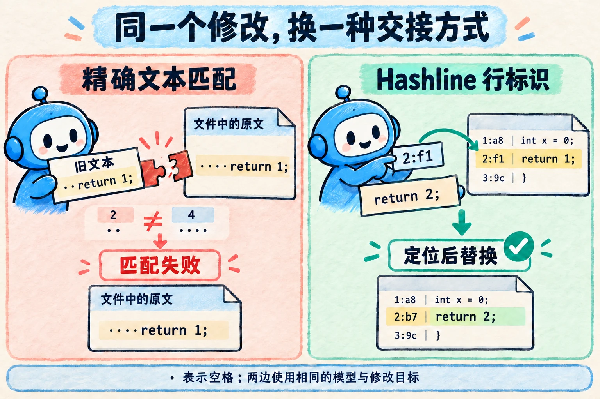
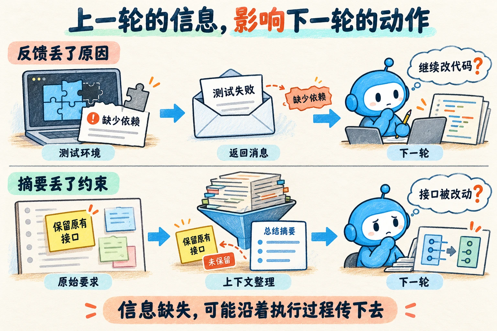

让 AI 修复一个函数，它找到了错误，也写出了合理的修改，工具却返回：“要替换的文本未找到。”原因可能只是旧代码里的一处缩进没有对齐。接下来几轮，它反复尝试同一次编辑，代码始终没有改成。

正确的修复思路，需要经由可靠的接口，才能变成文件中的改动。**模型决定了它能提出什么方案，围绕模型的执行系统则影响这些方案能否落实，以及遇到问题后能否继续推进。** 这套系统称为 **Agent Harness**。

这个系列以综述 [*Agent Harness Engineering: A Survey*](https://picrew.github.io/LLM-Harness/) 为起点，研究这段从方案到结果的过程：工具怎样执行，上下文怎样延续，错误怎样被发现，最终又凭什么认定任务完成。

## 一、换一种编辑方式，同一个模型也会表现不同

“替换文本”看起来是一个简单工具：给出旧代码和新代码，程序找到旧代码，再把它换掉。可要调用成功，模型必须准确复述旧代码，包括空格、缩进和换行。修复逻辑正确，仍可能在这一步失败。

综述引用了 Can Bölük 的一组实验：保持模型不变，比较不同的编辑工具格式。其中一种叫 **Hashline**，会在读取文件时给每行附上短标识，模型修改时引用这些标识定位代码，减少复述旧内容的负担。作者报告，在其构造的代码修复基准中，更换编辑格式显著改变了多个模型的通过率。[实验原文](https://stencil.so/blog/the-harness-problem)

*机制示意：点号代表空格，哈希值仅作示意。右侧修改后，行内容的哈希也随之更新；执行时仍需校验标识与当前文件是否匹配。*

这组实验的任务和评分方式有特定范围，不能据此认定一种格式适合所有场景。它提供的启发很明确：**工具接口本身也是影响任务表现的变量。** 当一次修改失败，我们需要检查模型提出的方案，也需要检查方案经过什么接口、遇到了什么反馈。

由此，研究对象扩大了：从模型生成的内容，走向模型与外部程序怎样配合。

## 二、任务一旦需要连续执行，问题就会彼此牵连

当读文件、编辑和测试等工具都接入系统，模型就可以请求执行这些操作。每次工具执行的结果被送回模型，成为下一步的依据。这种“调用模型 → 执行操作 → 返回结果”的反复过程，称为 **Agent loop（智能体执行循环）**。

但循环能够运行，只说明任务有了推进方式。连续做下去，还需要保持前后步骤的一致。

例如，模型修改代码后运行测试，命令因为缺少依赖而失败。如果返回信息没有说清原因，它可能误以为修改有问题，继续调整原本正确的代码。执行环境和错误反馈，会一起影响后续判断。

随着读取的文件和测试输出增多，一次调用能看到的信息，也就是 **上下文（Context）**，需要重新整理。若整理时丢掉了“保留原有接口”这项要求，后续修改就可能偏离目标。若执行中断，还需要分清：哪些文件已经写入，哪些测试尚未运行，哪些操作可以安全重试。

*机制示意：上方的模型只收到“测试失败”，没有收到缺少依赖的具体原因；下方的摘要遗漏了原始约束。问号表示可能出现的偏差，实际动作取决于后续输入与检查。*

到这里，单独检查每一步已经不够。我们还需要还原整个经过、检查最终结果，并约束程序能够修改的范围。**一次工具调用的成败，会改变下一轮输入；下一轮输入又会影响接下来的动作。Harness 要组织的，就是这样一个持续反馈的执行过程。**

## 三、七层分类，帮助我们沿着失败找到原因

前面的问题涉及不同职责，也经常同时发生。论文用 **ETCLOVG** 七层分类组织这些职责，让我们能够分别研究，再追踪它们之间的联系。

| 职责 | 官方名称 | 沿着刚才的例子看 |
| --- | --- | --- |
| **E · 执行环境** | Execution environment | 测试在哪运行，依赖是否齐全，文件操作受到什么隔离限制。 |
| **T · 工具接口** | Tool interface | 修改怎样表达给程序，执行结果和错误怎样返回。 |
| **C · 上下文管理** | Context management | 下一轮保留哪些要求、代码、历史和记忆。 |
| **L · 生命周期与编排** | Lifecycle / Orchestration | 怎样继续、重试、恢复、交接和结束。 |
| **O · 可观测性** | Observability | 留下哪些记录，才能还原这次任务的经过。 |
| **V · 验证** | Verification | 用什么证据确认修复，并判断系统改动的效果。 |
| **G · 治理** | Governance | 哪些操作得到授权，哪些需要阻止或交给人决定。 |

前四层描述执行的核心职责，后三层围绕它们提供观察、评估与约束。它们并非七个依次通过的关卡：运行一次测试，就会同时涉及工具、环境、权限、记录与结果检查。

这套分类的用处，是让排查有具体落点。比如，代码没有改成，可以先看工具调用是否被拒绝；修改后来偏离要求，可以追查相关要求在哪一轮输入中丢失。问题定位以后，再判断应该调整接口、上下文还是其他机制。

:::note[分层之后，还要重新连起来]
论文最后讨论了层与层之间的相互影响：更改工具描述会改变模型输入，增加检查会增加耗时，压缩历史可能损失后续所需的信息。因此，一个机制在局部看起来更好，仍需要放回完整任务中检验。
:::

## 四、沿着问题展开，逐步学会改进系统

这个系列的目标，是读完后能够解释一次任务怎样完成，也能在失败时提出有依据的检查与改进。后续按四个阶段展开，初步安排十二篇正文：

| 阶段 | 内容安排 | 要解决的问题 |
| --- | --- | --- |
| **先运行起来** | 01 执行循环 · 02 工具接口 · 03 执行环境 | 一个请求怎样变成实际操作，结果怎样回到下一轮？ |
| **再持续推进** | 04 上下文 · 05 持久记忆 · 06 中断恢复 · 07 多 Agent 协作 | 任务变长、跨会话或需要分工以后，怎样保持进度与方向？ |
| **看清并约束执行** | 08 权限与治理 · 09 过程记录与排查 | 操作边界怎样生效，失败怎样被还原？ |
| **用证据决定改进** | 10 任务验收 · 11 改动评估 · 12 机制取舍 | 怎样确认任务完成，又怎样证明一次系统调整值得保留？ |

每篇从一个具体问题出发，解释机制，追踪实现，再检查它实际改变了什么。七层提供研究地图，文章顺序则跟着问题逐步深入。权限和验收从最初的例子就会出现，再在相应篇目中展开。

下一篇先拆开一个最小执行循环，沿着一次工具调用找到三个位置：请求由谁接住，结果由谁送回，以及系统凭什么决定继续或停止。

参考：[综述 PDF](https://picrew.github.io/LLM-Harness/main.pdf) §1、§2.3、§10—12。文中的连续执行案例用于解释问题之间的联系；分篇与阅读顺序是本系列的安排。

---

*本文由 AI（Codex）生成，经人工审阅；正文插图由 AI 生成，封面为 SVG 图解。*
